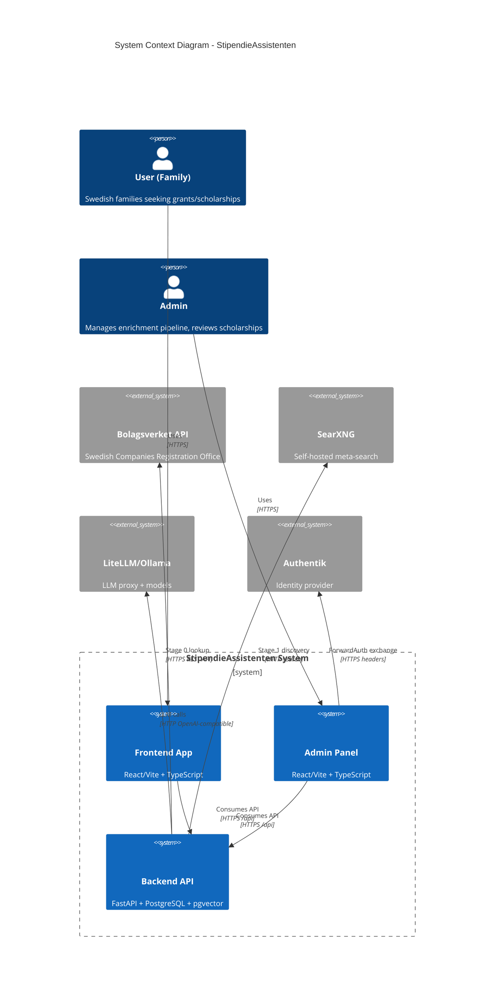
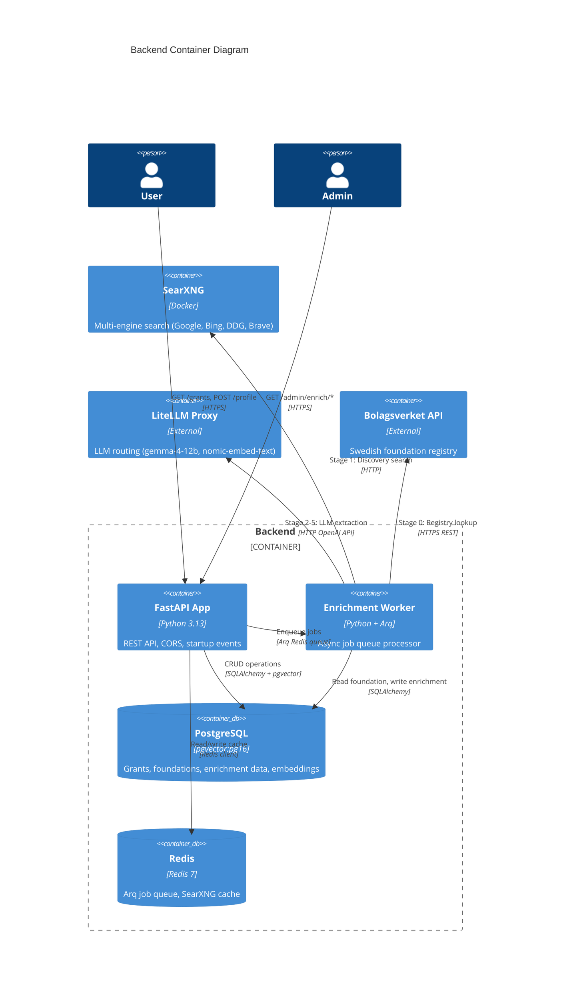
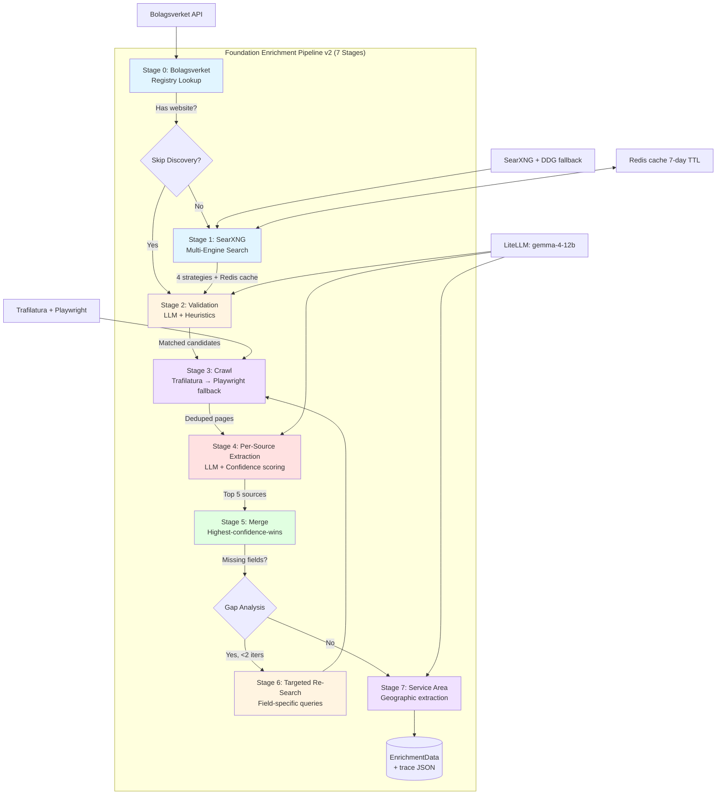
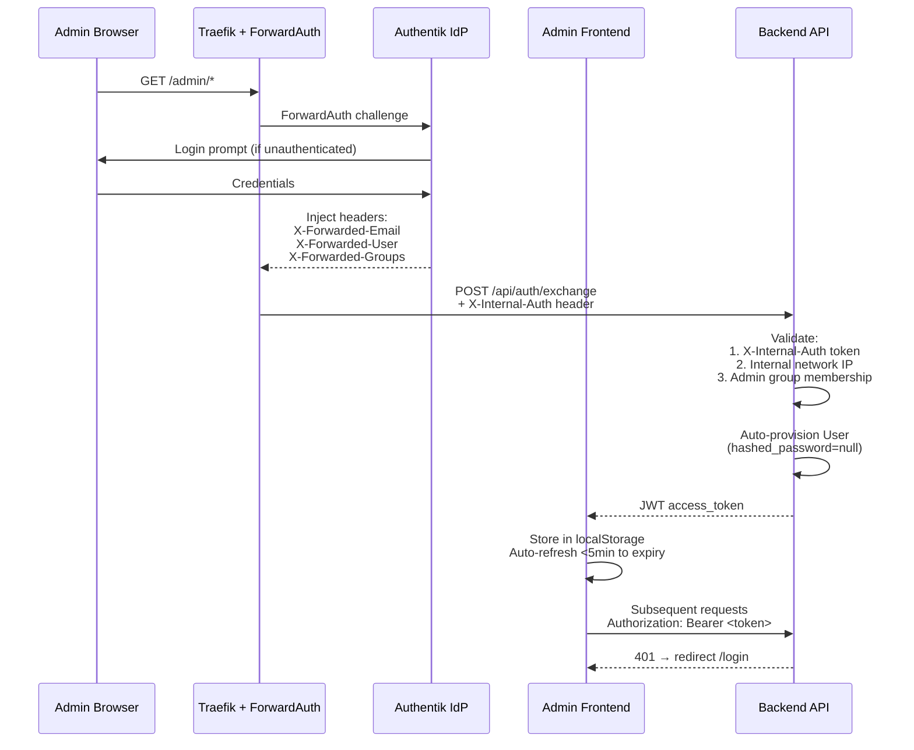
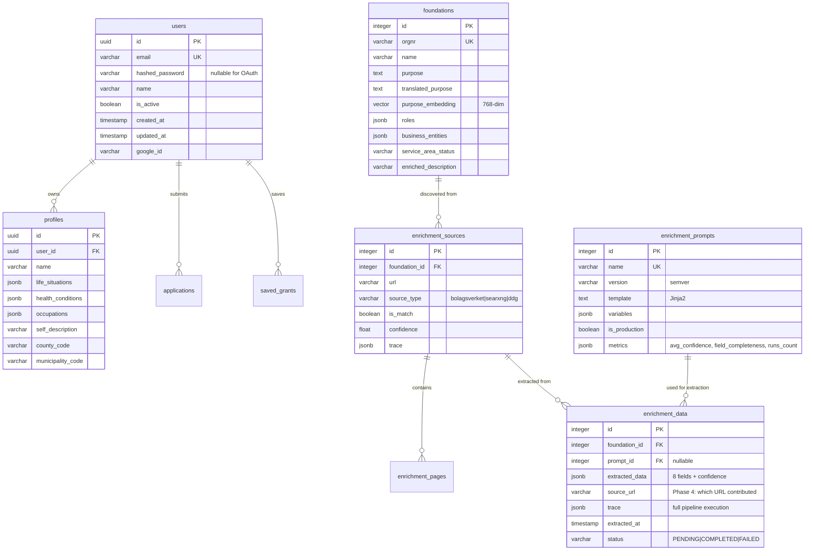
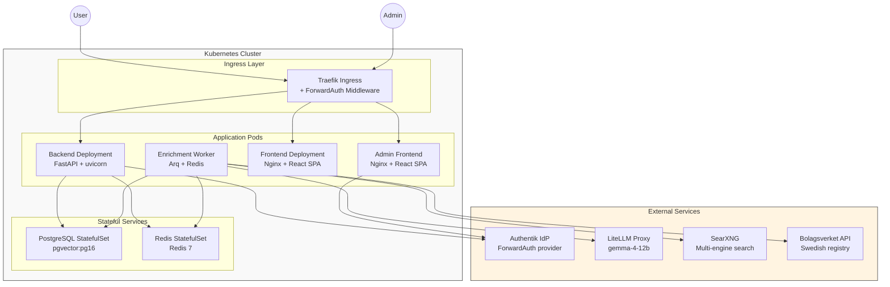

# StipendieAssistenten Architecture Overview

## System Context Diagram



## Container Diagram (Backend Focus)



## Enrichment Pipeline v2 Flow



## Admin Authentication Flow (Authentik ForwardAuth)



## Database Schema (Key Entities)



## Frontend Architecture

```mermaid
flowchart LR
  subgraph Frontend["apps/frontend"]
    A[App.tsx<br/>Router + Providers] --> B[Pages]
    B --> C1[Home]
    B --> C2[Grants]
    B --> C3[Matching]
    B --> C4[Generate]
    B --> C5[Family Setup]

    D[features/grants] --> E[hooks/useGrantsList.ts]
    D --> F[hooks/useSavedGrants.ts]
    D --> G[components/GrantCard.tsx]

    H[lib/api.ts] --> I[@stipendariet/api-client]
    J[contexts/AuthContext] --> K[JWT storage]
    L[contexts/ProfileContext] --> M[Profile state]
  end

  subgraph Shared["Shared Packages"]
    I --> N[@stipendariet/types<br/>Type definitions]
    O[@stipendariet/ui<br/>Radix components]
  end

  subgraph Admin["apps/admin"]
    P[EnrichmentResultsPage] --> Q[Per-field source + confidence]
    P --> R[View Trace modal]
    S[EnrichmentPromptsPage] --> T[Prompt versioning UI]
  end

  style Frontend fill:#e1f5ff
  style Shared fill:#f0f0f0
  style Admin fill:#ffe1e1
```

## Deployment Topology (Kubernetes)



## Key Architectural Decisions

| Decision | ADR | Rationale |
|----------|-----|-----------|
| **Alembic migration gating** | ADR-0001 | Fail-fast with clear error if DB revision unknown to image |
| **Model separation** | ADR-0004 | One file per entity, single `Base` in `__init__.py` |
| **Authentik ForwardAuth** | ADR-0003 | Tokenless exchange, auto-provisioning, centralized identity |
| **Pipeline service abstraction** | ADR-0008 | `PipelineStage` interface, `PipelineContext` for state |
| **SearXNG multi-engine** | ADR-0011 | 4x coverage, self-hosted, Redis cache, DDG fallback |
| **Bolagsverket Stage 0** | ADR-0010 | Authoritative data, skip Discovery when official site found |
| **Prompt versioning** | ADR-0009 | Jinja2 templates, A/B testing, metrics tracking |
| **Confidence-based merge** | ADR-0012 | Per-field confidence, targeted re-search, observability |

## Technology Stack Summary

| Layer | Technology | Version | Notes |
|-------|------------|---------|-------|
| **Backend** | FastAPI + uvicorn | Python 3.13 | Async API, CORS, startup events |
| **Database** | PostgreSQL + pgvector | 16 | Embeddings, text search |
| **Cache/Queue** | Redis | 7 | Arq job queue, SearXNG cache |
| **LLM** | LiteLLM proxy + Ollama | gemma-4-12b | OpenAI-compatible API |
| **Search** | SearXNG | latest | Google, Bing, DDG, Brave engines |
| **Frontend** | React + Vite | 18 + 5 | SWC, TypeScript, shadcn-ui |
| **Admin** | React + Vite | 18 + 5 | Radix UI, React Query |
| **Shared Types** | TypeScript | workspace | `@stipendariet/types` |
| **UI Components** | Radix + Tailwind | 3.x | `@stipendariet/ui` |
| **Auth** | Authentik + JWT | ForwardAuth | Tokenless exchange |
| **Deployment** | Kubernetes + helmfile | - | Traefik ingress, StatefulSets |

---

## Related Documentation

- [ADR Index](./adr/) — All architectural decision records
- [Enrichment Pipeline User Guide](./enrichment-pipeline.md) — Admin usage
- [CONTEXT.md](../CONTEXT.md) — Domain language and concepts
- [AGENTS.md](../AGENTS.md) — Agent instructions for this repo